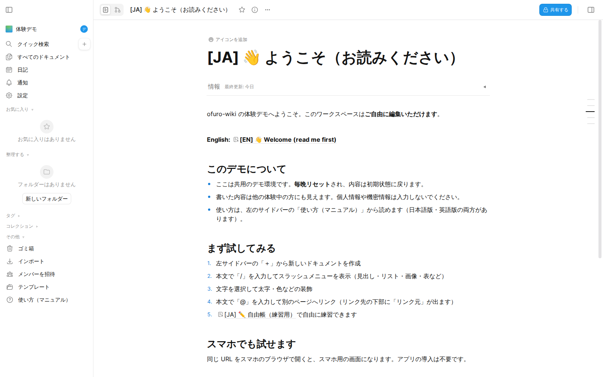
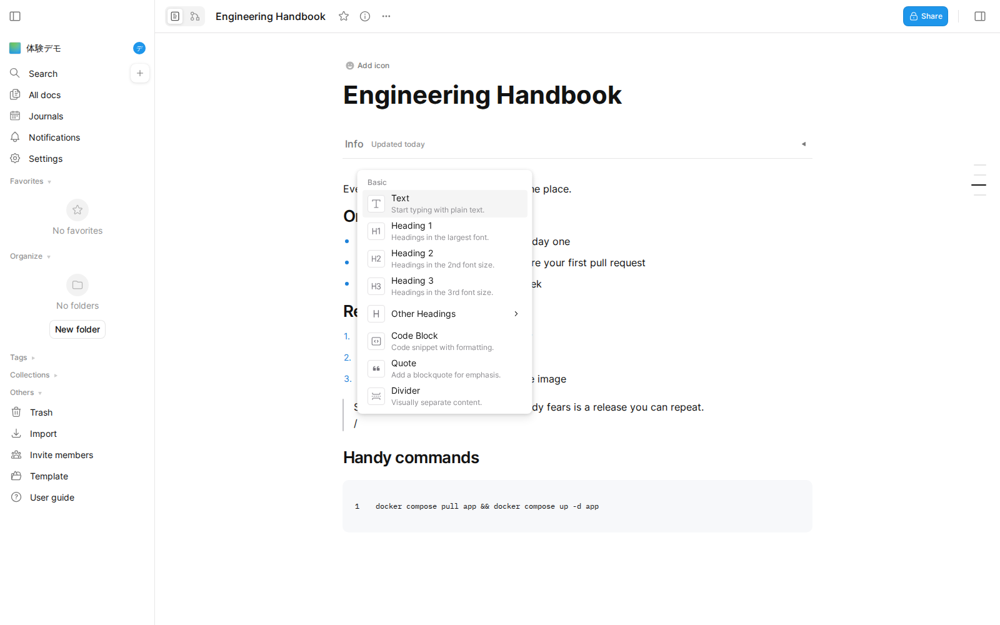
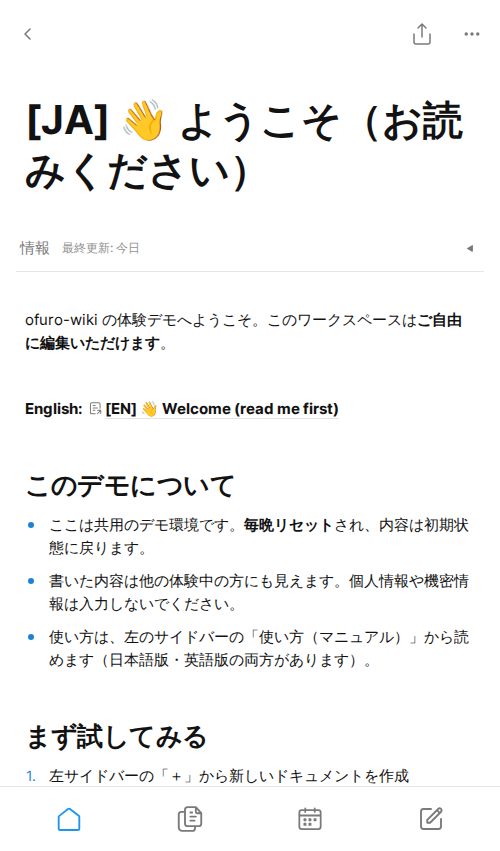

# ofuro-wiki

<p align="center">
  
</p>

<p align="center">
  <a href="README.md">English</a> | <b>日本語</b>
</p>

<p align="center">
  <b>セルフホスト型の Notion に代わる新しい選択肢。外部送信ゼロ設計、MIT ライセンス。</b><br>
  アイデアが湧き出てくる、セキュアな社内 Wiki プラットフォーム。<br>
  お風呂（ofuro）のように、自然とアイデアが出てくる場所をイメージして。
</p>

<p align="center">
  <a href="LICENSE"></a>
  <a href="https://github.com/ulysseus-inc/ofuro-wiki/releases"></a>
  <a href="https://github.com/ulysseus-inc/ofuro-wiki/pkgs/container/ofuro-wiki"></a>
</p>

<p align="center">
  
  
</p>

<p align="center">
  
</p>

<p align="center">
  
  <br>
  <sub>スマホでも使えます。アプリの導入は不要です。</sub>
</p>

---

## なぜ作ったか

社内の知識を蓄積・共有するために、Notion のような使いやすさを持ちながら、データは自社の環境で管理できるツールが欲しいと考えていました。

SaaS ではデータを社外に預けることになるため、私たちの考えには合いません。そこで、社内に構築できる Wiki を探しましたが、ライセンスや機能面で、これだと思えるものが見つかりませんでした。

それなら自分たちで作ろうと考え、オープンソースのエディタ技術（[AFFiNE](https://github.com/toeverything/AFFiNE) のフロントエンド）を活用しながら、バックエンドを独自に開発しました。NestJS、PostgreSQL、PGroonga を組み合わせた Wiki プラットフォーム、それが ofuro-wiki です。

独自に開発した部分は MIT ライセンスで公開しています。第三者のライブラリについては、それぞれのライセンスに従っています。

ofuro-wiki では、特に次の 2 つを大切にしています。

- **社内のデータを外部に送信しないことを基本とした設計**
- **閲覧権限のないページは、一覧や検索結果にも表示しないこと**

現在は、自社の本番環境で日々利用しています。

> **現在**: 最新は v0.3.0 です。Issue や質問を歓迎します。

## セルフホストできる Wiki との違い

ofuro-wiki を探す人は、たいてい「自分のサーバーに立てられる、ブロックエディタの Wiki」を探している。
その括りで名前が挙がることが多い3つと並べた。**AFFiNE** は本フォークの上流であり、
**Outline** と **Docmost** はこの分野の定番である。
（Wiki.js や BookStack のような従来型の Wiki は、編集の作りが違うので入れていない）

| | ofuro-wiki | AFFiNE（本家） | Outline | Docmost |
|---|---|---|---|---|
| ライセンス（全体） | **MIT** | エディタ MIT ／ **サーバーは商用** | **BSL 1.1**（2030-09 に Apache-2.0 へ） | AGPL-3.0 |
| 全部を自前で動かせるか | **できる** | サーバーに商用ライセンスが要る | できる | できる |
| エディタ | BlockSuite（AFFiNE 由来） | BlockSuite | リッチテキスト | リッチテキスト |
| ページ単位の権限 | **あり。読めないページは一覧にも出ない** | ワークスペース単位 | あり | あり |
| 既定での外部通信 | **なし**（実測して確かめている） | 上流にテレメトリのコードあり。本フォークでは除去済み | 既定 `ENABLE_UPDATES=true`。匿名の統計を開発元へ送る | 既定 `DISABLE_TELEMETRY=false`（＝テレメトリ有効） |
| 日本語の全文検索 | **あり（PGroonga）** | あり | 構成次第 | 構成次第 |

2026-09 時点で、各プロジェクトが公開している設定例で確認した
（[Outline `.env.sample`](https://github.com/outline/outline/blob/main/.env.sample) /
[Docmost `.env.example`](https://github.com/docmost/docmost/blob/main/.env.example)）。
⚠️ **いずれも設定で止められる。** 表に書いたのは**既定値**である。
優劣ではなく違いを並べたもので、いずれも良いプロジェクトであり、ofuro-wiki は AFFiNE があって成り立っている。

## 中身ではなく、存在を隠す

多くの Wiki は、読めないページの**中身**は隠すが、題は一覧や検索に出る。
ofuro-wiki は違う。**読めないページは、一覧にも検索結果にも、どこにも現れない。**
題も漏れない。「共有されていない」は「存在しない」と同じ意味になる。

## ライブデモ

インストール不要で、すぐに触れます。

**▶ [https://ofuro-wiki-demo.ulysseus.co.jp](https://ofuro-wiki-demo.ulysseus.co.jp)**

| ログイン | |
|---|---|
| メールアドレス | `demo@demo.com` |
| パスワード | `demodemo` |

> 共用のデモ環境です。毎晩 3:00（JST）に初期状態へリセットされます。
> 機密情報は入力しないでください。

---

## 特徴

- **Notion ライクなブロックエディタ** — BlockSuite による `/` コマンド・ドラッグ&ドロップ
- **リアルタイム同期** — Yjs + Socket.IO による複数人同時編集
- **ページ単位の権限** — ページごとに書き込み・参照の権限を設定できる。
  権限のない利用者には、そのページは一覧にも出ない（**中身だけでなく、存在そのものを隠す**）
- **全文検索とバックリンク** — PGroonga による日本語対応の高速検索。
  どのページから参照されているかが各ページに出る
- **スマホで使える** — ブラウザに応じてスマホ用の画面を自動で配信。アプリの導入は不要
- **監査ログ** — 誰が・いつ・何をしたかを記録。管理画面から参照できる
- **シングルサインオン（SSO）** — OIDC 対応。Google・Keycloak 等のアカウントでサインイン（[設定手順](site/guide/integration.md)）
- **AI エージェント連携** — Claude Code などの AI エージェントが、普通の利用者としてページを検索・閲覧・編集できます。権限も監査ログも人と同じで、編集は開いているブラウザにリアルタイムに反映されます（[設定手順](site/guide/integration.md)）
- **プライベートと共有のワークスペース** — 1 人に 1 つの下書き用のプライベートと、システム管理者が作る全社・部署ごとの共有
- **ガイドを同梱** — 導入ガイドと使い方を、本体が `/docs/` で配る（日本語・英語）。インターネットにつながない環境でも読める
- **セルフホスト完結** — Docker 1コマンドで起動、外部サービス依存なし
- **プライバシー重視** — テレメトリ・外部送信を完全無効化

## v0.3.0 でできること

| 区分 | 内容 |
|---|---|
| **書く** | `/` コマンド・ドラッグ&ドロップ・表・コードブロック、自作の段組みブロック。Markdown / HTML / Notion エクスポートからのインポート、PDF / Markdown / HTML への書き出し。うっかり書き換えを防ぐ保護モード |
| **見つける** | 日本語に強い全文検索（PGroonga）、各ページのバックリンク、ページをつなぎ相手に通知する `@` メンション、タグとフォルダ |
| **共有する** | プライベート（1 人に 1 つ）と共有（システム管理者が作る）のワークスペース。ワークスペースごとの招待と役割、**ページ単位**の読み書き権限 |
| **秘密を守る** | 読めないページは一覧に出ない（題も漏れない）。テレメトリなし。機能を自分で有効にしない限り外部への通信もなし |
| **運用する** | 管理画面（利用者管理・CSV での一括登録・監査ログ・サーバー設定・バックアップ/リストア）、ワークスペース単位の書き出しと取り込み、ゴミ箱と完全削除、OIDC による SSO（接続テスト付き） |
| **ガイド** | 導入ガイドと使い方を、本体が `/docs/` で配る（日本語・英語） |
| **端末** | PC のブラウザとスマホ。スマホ用の画面はブラウザに応じて自動で配信。画面は日本語と英語 |

版ごとの変更点と、v0.2 からの上げ方は [リリースノート](https://github.com/ulysseus-inc/ofuro-wiki/releases) を見てください。

## 技術スタック

| 区分 | 技術 |
|------|------|
| フロントエンド | AFFiNE (MIT) + BlockSuite (MPL-2.0) |
| バックエンド | NestJS + GraphQL + Socket.IO（※独自開発） |
| データベース | PostgreSQL + PGroonga（全文検索） |
| 認証 | JWT |
| インフラ | Docker / Docker Compose |

> ※ AFFiNE のバックエンドは商用ライセンス（EE）のため、ofuro-wiki では
> バックエンドを独自開発しています。これにより全体を MIT ライセンスで提供できます。

## ガイド

ガイドは本体に入っています。ofuro-wiki の **`/docs/`**（例: `http://localhost:3010/docs/`）を開くか、
サイドバーの「**使い方（マニュアル）**」から開けます。同じ内容がこのリポジトリにもあります。

| ガイド | 読む人 | |
|---|---|---|
| **導入と運用** | 管理者 | [site/guide](site/guide/introduction.md) — クイックスタート・社内サーバーへの導入・初期設定・ユーザーとアクセス制限・バックアップとバージョンアップ・SSO と AI エージェント・困ったとき |
| **使い方** | 利用者 | [site/user](site/user/index.md) — ページとブロック・エディタ・検索とタグ・共有と権限・スマホ |

## クイックスタート

必要なのは **Docker** だけです。公開済みのイメージを使うので、リポジトリのクローンやビルドは要りません。

**▶ [クイックスタート](site/guide/quickstart.md)** — 手元の PC で 10 分ほどで試せます。

| 使い方 | 要るもの |
|---|---|
| 手元の PC で試す | Docker、メモリに 2GB ほどの空き |
| 社内サーバー | Ubuntu Server 24.04、メモリ 4GB 以上、ディスク 20GB 以上の空き（[手順](site/guide/install-server.md)） |
| Windows PC をサーバーにする | Windows 11、メモリ 8GB 以上（[手順](site/guide/install-windows.md)） |

メモリ 1GB ＋ Swap 2GB でも動きます（社内本番と公開デモは GCE e2-micro で動いています）。ただし、サインインが集中すると遅くなります。

社内の他の PC から使うときは、続けて [社内サーバーへの導入](site/guide/install-server.md)（自前の認証局による HTTPS）に進みます。

## ロール体系

権限は 3 段です。

```
① サーバー         root（ROOT_EMAIL・1 人・消せない） ⊂ システム管理者 ／ 一般ユーザー
   └ ② ワークスペース  プライベート（1 人 1 つ・本人だけ）
                       共有（システム管理者が作る・持ち主は root）
                         ワークスペース管理者 > メンバー > 閲覧者
        └ ③ ページ      管理可能 > 編集可能 > 読み取り専用 > アクセス不可
```

| 立場 | 決め方 | できること |
|---|---|---|
| **root** | `.env` の `ROOT_EMAIL`（1 人） | システム管理者のすべて。誰にも消せず、管理者も外せない。すべての共有ワークスペースの持ち主 |
| **システム管理者** | 設定 →「ユーザー管理」でオンにする | ユーザー・共有ワークスペース・サーバー設定・監査ログ・バックアップ。招待なしで共有を管理できるが、ほかの人のプライベートは開けない |
| **ワークスペース管理者** | システム管理者が選ぶ | その共有ワークスペースの設定と招待 |
| **メンバー** | 招待する | ページの読み書き |
| **閲覧者** | 招待した後に切り替える | ページを読むだけ |

詳しくは [ユーザーとアクセス制限](site/guide/users-and-access.md) を見てください。

## デプロイ

画面を追った導入の手順は [社内サーバーへの導入](site/guide/install-server.md) を見てください。
設定項目の詳しい説明（Nginx / Caddy、Swap、ログイン試行の制限など）は
[docs/deploy/README.md](docs/deploy/README.md) にあります。

### HTTP と HTTPS でのクリップボード動作の違い

ブラウザのセキュリティ仕様により、`navigator.clipboard` API は **HTTPS（またはlocalhost）でのみ** 利用可能です。
ofuro-wiki は HTTP 環境でもクリップボードが使えるよう対応していますが、動作に差があります。

| 操作 | HTTPS / localhost | HTTP（IPアドレス等） |
|------|:-----------------:|:--------------------:|
| エディタ内コピー＆ペースト | ✅ フル機能 | ✅ 動作する |
| 他アプリ（テキストエディタ等）へのペースト | ✅ フル機能 | ✅ プレーンテキストとして動作 |
| 他アプリからエディタへのペースト | ✅ フル機能 | ✅ 動作する |
| 別タブ・別ウィンドウ間のコピー＆ペースト | ✅ フル機能 | ❌ 動作しない |

> **本番・社内運用では HTTPS を強く推奨します。**
> HTTP のみで運用する場合は [パターン C](docs/deploy/pattern-C.md) を参照してください。

## セキュリティとプライバシー

ofuro-wiki は**外部への一切のデータ送信を行いません**。社内の機密情報を安心して管理できるよう、テレメトリ・トラッキングを設計レベルで完全に排除しています。

| 対策 | 内容 |
|------|------|
| **テレメトリ完全排除** | 上流の AFFiNE に含まれる Mixpanel・Sentry 等のテレメトリコードをすべて no-op スタブに置換。トラッキング関数は呼び出しても何も実行されません |
| **外部エンドポイントなし** | テレメトリ送信先 URL・API キー・DSN 等の設定値を一切保持しません |
| **Sentry 無効化** | エラー報告の外部送信を完全に無効化。`sentry.init()` は呼び出されません |
| **localStorage 汚染なし** | テレメトリ用のクライアント ID・セッション ID 等をブラウザに保存しません |
| **エアギャップ対応** | インターネット接続なしの完全閉域環境でも動作します |

> フォーク元の AFFiNE フロントエンドには 100 以上のファイルにトラッキング呼び出しが残っていますが、すべて no-op（何もしない関数）に差し替え済みです。コードパス上でイベント送信は一切発生しません。あわせて、コードプレビューの外部サンドボックス（affine.run）・外部 Web フォント（cdn.affine.pro / Google Fonts）といった**アプリ起因の外部読み込みも削除**しています。

> **補足（ユーザー操作起因の外部読み込みについて）**: 上記の「外部送信ゼロ」は、ユーザーが意図せず発生するテレメトリ・phone-home を設計レベルで排除することを指します。ユーザー自身が文書に外部コンテンツ（YouTube 動画の埋め込み・外部画像 URL 等）を挿入した場合、その表示時には当該コンテンツが提供元から読み込まれます。完全閉域での運用を徹底する場合は、リバースプロキシや CSP（`connect-src`/`frame-src` 等）で外部宛先を制限してください。

### リンクプレビュー・リッチ埋め込み（既定 OFF）

ブックマークや埋め込みブロック（YouTube・GitHub・Figma・Loom 等）のリッチ表示（タイトル・サムネイル・説明）には、対象 URL の OGP メタデータ取得が必要です。ofuro-wiki は上流 AFFiNE の**外部 Worker を使わず自サーバー内**（`/api/worker/link-preview`・`/api/worker/image-proxy`）で完結させています。

- **既定は OFF**（no-op）で、サーバーから外部への接続は発生しません（**外部送信ゼロを維持**）。この場合、埋め込みの iframe 再生などは動きますが、リッチなプレビューカードは表示されません。
- **システム管理者が 設定 →「サーバー設定」→「リンクプレビュー・リッチ埋め込み」を ON** にすると、ユーザーが貼り付けた URL について**サーバーがその外部サイトへ接続**してメタデータ・画像を取得します（＝ユーザー操作起因の外部送信）。システム管理者以外は、この設定を変更できません。SSRF 対策（内部アドレス遮断・リダイレクト再検証・サイズ/タイムアウト上限）を実装しています。
- 完全閉域運用を維持したい場合は **OFF のまま**にしてください。

## 開発

ローカルでの開発環境セットアップ（依存インストール・DB・マイグレーション・dev サーバ起動・E2E）は [docs/development.md](docs/development.md) を参照してください。

## コントリビューション

**バグ報告・機能提案は [Issue](../../issues) で歓迎します。**
ただし公開初期は運用安定のため、**外部からの Pull Request は現在受け付けていません**
（コード変更はメンテナのみ。方針は今後変更される場合があります）。

- 詳細・方針: [CONTRIBUTING.md](CONTRIBUTING.md)
- 行動規範: [CODE_OF_CONDUCT.md](CODE_OF_CONDUCT.md)
- セキュリティ脆弱性の報告（**公開 Issue にしないでください**）: [SECURITY.md](SECURITY.md)

## 製品としての ofuro-wiki

開発元はユリシーズ株式会社です。導入相談・評価環境の申し込みは、製品ページから承っています。

**▶ [https://www.ulysseus.co.jp/ofuro-wiki](https://www.ulysseus.co.jp/ofuro-wiki)**

⚠️ ソフトウェア自体は MIT ライセンスです。**上記の申し込みをしなくても、自由に自分のサーバーで動かせます。**

## ライセンス

ofuro-wiki 本体: **MIT License** — 詳細は [LICENSE](LICENSE) を参照。

本プロジェクトは [AFFiNE](https://github.com/toeverything/AFFiNE)（フロントエンド: MIT）の派生で、エディタの [BlockSuite](https://github.com/toeverything/blocksuite) 由来ファイルは **MPL-2.0**（ファイル単位）です。その他、libvips（LGPL-3.0）等を含みます。

- 第三者依存のライセンス監査結果: [THIRD-PARTY-LICENSES.md](THIRD-PARTY-LICENSES.md)
- 各コンポーネントの帰属表示: [NOTICE](NOTICE)
