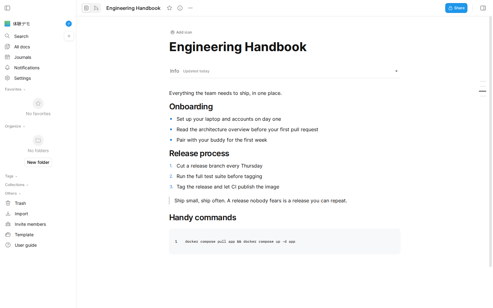
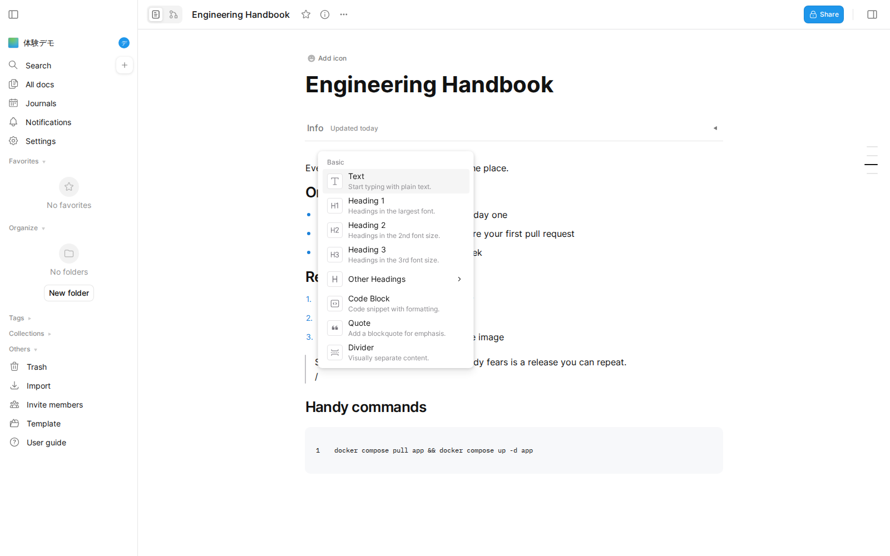
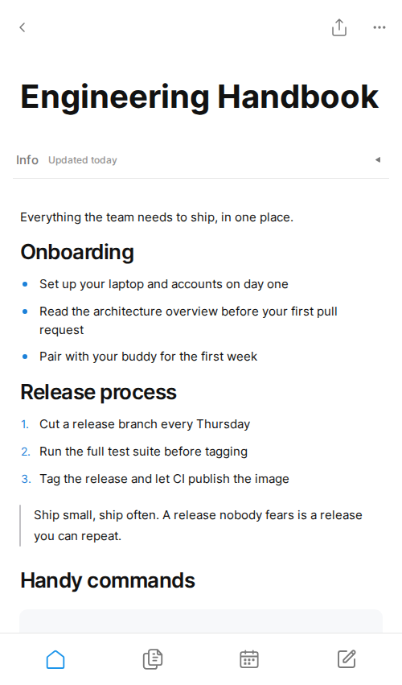

# ofuro-wiki

<p align="center">
  
</p>

<p align="center">
  <b>English</b> | <a href="README.ja.md">日本語</a>
</p>

<p align="center">
  <b>A self-hosted, privacy-first Notion alternative.</b><br>
  <b>Zero external data transmission by design — MIT licensed.</b><br>
  A secure wiki platform where ideas flow naturally, named after the Japanese bath
  (<i>ofuro</i>) — a place where ideas come to you.
</p>

<p align="center">
  <a href="LICENSE"></a>
  <a href="https://github.com/ulysseus-inc/ofuro-wiki/releases"></a>
  <a href="https://github.com/ulysseus-inc/ofuro-wiki/pkgs/container/ofuro-wiki"></a>
</p>

<p align="center">
  
  
</p>

<p align="center">
  
</p>

<p align="center">
  
  <br>
  <sub>Works on phones too — no app to install.</sub>
</p>

---

## Why this exists

We wanted a tool for building up and sharing what our company knows — as easy to use as Notion, but with our data kept in our own environment.

SaaS means handing our data to someone else, which does not fit our requirements. So we looked for a wiki we could run in-house, but nothing felt right in terms of licensing or features.

So we decided to build our own. We used open-source editor technology (the [AFFiNE](https://github.com/toeverything/AFFiNE) frontend) and developed our own backend. The result — a wiki platform built on NestJS, PostgreSQL, and PGroonga — is ofuro-wiki.

The parts we developed ourselves are released under the MIT License. Third-party libraries follow their own licenses.

Two things matter most to us:

- **Designed from the ground up so that company data is not sent outside**
- **Pages you have no permission to read do not appear in lists or search results**

We use it in our own production environment every day.

> **Status**: v0.3.0 is the current release. Issues and questions are welcome.

## How it compares to other self-hostable wikis

People who find ofuro-wiki are usually looking for a block-based wiki they can run on their own server.
These three come up most often in that search: **AFFiNE** is the upstream this project forks, and
**Outline** and **Docmost** are the established choices in the space.
(Traditional wikis such as Wiki.js and BookStack are a different kind of editing experience, so they are not listed.)

| | ofuro-wiki | AFFiNE (upstream) | Outline | Docmost |
|---|---|---|---|---|
| License (whole stack) | **MIT** | Editor MIT / **server commercial** | **BSL 1.1** (becomes Apache-2.0 in 2030-09) | AGPL-3.0 |
| Self-host everything | **Yes** | Server needs a commercial license | Yes | Yes |
| Editor | BlockSuite (from AFFiNE) | BlockSuite | Rich text | Rich text |
| Per-page permissions | **Yes — a page you cannot read is not listed at all** | Workspace-level | Yes | Yes |
| Outbound traffic by default | **None** (we measure it) | Telemetry code in the upstream codebase — removed in this fork | `ENABLE_UPDATES=true` by default: sends anonymized statistics to the maintainers | `DISABLE_TELEMETRY=false` by default |
| Japanese full-text search | **Yes (PGroonga)** | Yes | Depends on setup | Depends on setup |

Checked 2026-09 against each project's own published configuration
([Outline `.env.sample`](https://github.com/outline/outline/blob/main/.env.sample),
[Docmost `.env.example`](https://github.com/docmost/docmost/blob/main/.env.example)).
**Every one of them can be turned off by configuration** — the table shows the *default*.
These are differences, not verdicts: all of them are good projects, and ofuro-wiki exists because of AFFiNE.

## Hiding existence, not just content

Most wikis hide the *content* of a page you may not read, but still show its title in lists and search.
ofuro-wiki does not: **a page you cannot read never appears in your list, your search results, or anywhere else.**
The title never leaks. "Not shared with me" means "does not exist".

## Live demo

Try it right now — no installation required.

**▶ [https://ofuro-wiki-demo.ulysseus.co.jp](https://ofuro-wiki-demo.ulysseus.co.jp)**

| Sign in | |
|---|---|
| Email | `demo@demo.com` |
| Password | `demodemo` |

> This is a shared demo environment. It resets to its initial state every night at
> 3:00 AM (JST). Please do not enter confidential information.

---

## Features

- **Notion-like block editor** — `/` commands and drag & drop, powered by BlockSuite
- **Real-time collaboration** — simultaneous editing via Yjs + Socket.IO
- **Per-page permissions** — set read and write access on each page. A page you do not
  have access to never appears in your list: its **existence is hidden, not just its content**
- **Full-text search and backlinks** — fast, Japanese-aware search powered by PGroonga.
  Every page shows which pages link to it
- **Works on phones** — the mobile build is served automatically based on the browser;
  no app to install
- **Audit log** — who did what, and when. Readable from the admin panel
- **Single sign-on (SSO)** — OIDC support: sign in with Google, Keycloak, and other providers ([setup guide](site/en/guide/integration.md))
- **AI agent access** — AI agents such as Claude Code can search, read, and edit pages as a regular user, with the same permissions and audit log as people. Edits appear live in open browsers ([setup guide](site/en/guide/integration.md))
- **Private and shared workspaces** — everyone gets a private workspace for drafts; system administrators create shared workspaces for the team or each department
- **Built-in user guide** — the installation guide and user guide ship with the server at `/docs/`, in English and Japanese. Readable on air-gapped networks too
- **Fully self-hosted** — start with a single Docker command, no external service dependencies
- **Privacy-first** — telemetry and outbound data transmission are disabled by design

## What's in v0.3.0

| Area | What you get |
|---|---|
| **Writing** | Block editor with `/` commands, drag & drop, tables, code blocks, and a custom multi-column block. Import from Markdown, HTML, and Notion exports; export to PDF, Markdown, and HTML. **Protected** mode to prevent accidental edits |
| **Finding** | Japanese-aware full-text search (PGroonga), backlinks on every page, `@`-mentions that link pages and notify people, tags and folders |
| **Sharing** | Private workspaces (one per person) and shared workspaces (created by system administrators). Invitations and roles per workspace, per-page read and write permissions |
| **Privacy** | A page you cannot read never appears in your list — the title is not leaked. No telemetry, no outbound calls unless you turn a feature on |
| **Operations** | Admin panel with user management (one by one or by CSV), audit log, server settings, and backup / restore. Export and import of a single workspace. SSO via OIDC with a connection test |
| **Documentation** | Installation guide and user guide served by the app itself at `/docs/` (English and Japanese) |
| **Devices** | Desktop browsers and phones. The mobile build is served automatically based on the browser. English and Japanese interface |

See the [release notes](https://github.com/ulysseus-inc/ofuro-wiki/releases) for what changed in each version,
including how to upgrade from v0.2.

## Tech stack

| Area | Technology |
|------|------------|
| Frontend | AFFiNE (MIT) + BlockSuite (MPL-2.0) |
| Backend | NestJS + GraphQL + Socket.IO (※ built in-house) |
| Database | PostgreSQL + PGroonga (full-text search) |
| Auth | JWT |
| Infra | Docker / Docker Compose |

> ※ AFFiNE's backend is commercially licensed (EE), so it is not used. ofuro-wiki
> implements its own backend, which is what makes it possible to offer the whole
> project under the MIT License.

## Documentation

The guides ship with the server: open **`/docs/`** on your ofuro-wiki (for example `http://localhost:3010/docs/en/`),
or **User guide** in the sidebar. The same pages are in this repository:

| Guide | For | |
|---|---|---|
| **Installation & operation** | Administrators | [site/en/guide](site/en/guide/introduction.md) — quick start, installing on a company server, initial setup, users and access, backups and upgrades, SSO and AI agents, troubleshooting |
| **User guide** | Everyone | [site/en/user](site/en/user/index.md) — pages and blocks, the editor, search and tags, sharing and permissions, phones |

## Quick start

All you need is **Docker**. Prebuilt public images are used, so there is no need to clone the repository or build anything.

**▶ [Quick start guide](site/en/guide/quickstart.md)** — try it on your own PC in about 10 minutes.

| Use | Requirements |
|---|---|
| Try it on your PC | Docker, about 2GB of free memory |
| Company server | Ubuntu Server 24.04, 4GB+ memory, 20GB+ free disk ([guide](site/en/guide/install-server.md)) |
| Windows PC as the server | Windows 11, 8GB+ memory ([guide](site/en/guide/install-windows.md)) |

It also runs on 1GB of memory plus 2GB of swap (our own production and the live demo run on a GCE e2-micro), though sign-in is slower when many people sign in at once.

To let other PCs in your company use it, continue with
[Installing on a company server](site/en/guide/install-server.md) (HTTPS with your own certificate authority).

## Roles

Permissions have three levels.

```
① Server     root (ROOT_EMAIL, one person, cannot be removed) ⊂ system admins / regular users
   └ ② Workspace  private (one per person, only that person)
                  shared (created by system admins, owned by root)
                    workspace admin > member > reader
        └ ③ Page   can manage > can edit > read only > no access
```

| Role | How it is decided | What they can do |
|---|---|---|
| **root** | `ROOT_EMAIL` in `.env` (one person) | Everything a system admin can do. Cannot be deleted or demoted. Owns every shared workspace |
| **System admin** | Turned on in **Settings** → **User Management** | Users, shared workspaces, server settings, audit log, backups. Manages any shared workspace without an invitation, but cannot open other people's private workspaces |
| **Workspace admin** | Chosen by a system admin | Settings and invitations of that shared workspace |
| **Member** | Invited | Read and write pages |
| **Reader** | Switched after inviting | Read pages only |

Details: [Users and access](site/en/guide/users-and-access.md).

## Deployment

For a step-by-step installation, see [Installing on a company server](site/en/guide/install-server.md).
Reference material for every setting (Nginx / Caddy, swap, sign-in limits, etc.) is in
[docs/deploy/README.md](docs/deploy/README.md) (Japanese).

### Clipboard behavior: HTTP vs HTTPS

Due to browser security policies, the `navigator.clipboard` API is available **only
over HTTPS (or on localhost)**. ofuro-wiki supports clipboard use over HTTP as well,
but the behavior differs:

| Operation | HTTPS / localhost | HTTP (IP address, etc.) |
|-----------|:-----------------:|:-----------------------:|
| Copy & paste within the editor | ✅ Full | ✅ Works |
| Paste into other apps (text editors, etc.) | ✅ Full | ✅ Works as plain text |
| Paste from other apps into the editor | ✅ Full | ✅ Works |
| Copy & paste across tabs/windows | ✅ Full | ❌ Not supported |

> **HTTPS is strongly recommended for production / organizational use.**
> If you must run over HTTP only, see [Pattern C](docs/deploy/pattern-C.md) (Japanese).

## Security & privacy

ofuro-wiki **does not send any data to external services**. Telemetry and tracking
are eliminated by design so that confidential information can be managed safely.

| Measure | Details |
|---------|---------|
| **Telemetry fully removed** | All telemetry code from upstream AFFiNE (Mixpanel, Sentry, etc.) is replaced with no-op stubs. Tracking functions do nothing when called |
| **No external endpoints** | No telemetry URLs, API keys, or DSNs are stored |
| **Sentry disabled** | Error reporting to external services is fully disabled; `sentry.init()` is never called |
| **No localStorage pollution** | No telemetry client/session IDs are stored in the browser |
| **Air-gap ready** | Runs in fully offline, closed networks |

> Upstream AFFiNE's frontend has tracking calls in 100+ files, but all of them are
> replaced with no-ops; no events are emitted on any code path. App-initiated external
> loads — the code-preview external sandbox (affine.run) and external web fonts
> (cdn.affine.pro / Google Fonts) — have also been removed.

> **Note (user-initiated external loads):** "Zero outbound transmission" refers to
> eliminating telemetry / phone-home that occurs without the user's intent. If a user
> embeds external content in a document (e.g. a YouTube video or an external image URL),
> that content is loaded from its origin when displayed. For strictly closed-network
> operation, additionally restrict outbound destinations with a reverse proxy or CSP
> (`connect-src` / `frame-src`, etc.).

### Link previews and rich embeds (off by default)

Rich previews of bookmarks and embeds (title, thumbnail, description for YouTube, GitHub, Figma, Loom, etc.)
need the target URL's OGP metadata. ofuro-wiki fetches it **on your own server**
(`/api/worker/link-preview`, `/api/worker/image-proxy`) instead of upstream AFFiNE's external worker.

- **Off by default** (no-op): the server makes no outbound connections. Embedded players still work,
  but rich preview cards are not shown
- When a **system administrator** turns on **Settings** → **Server Settings** → **Link Previews & Rich Embeds**,
  the server connects to the URLs users paste to fetch metadata and images (outbound traffic caused by a
  user's action). Other users cannot change this setting. SSRF protections are in place (internal addresses
  blocked, redirects re-checked, size and timeout limits)
- Keep it **off** for fully closed networks

## Development

For local development setup (dependency installation, database, migrations, dev servers,
and E2E tests), see [docs/development.md](docs/development.md).

## Contributing

**Bug reports and feature requests are welcome via [Issues](../../issues).**
However, to keep things stable in the early stage, **external Pull Requests are not
being accepted at this time** (code changes are made by the maintainers only; this
policy may change in the future).

- Details & policy: [CONTRIBUTING.md](CONTRIBUTING.md)
- Code of conduct: [CODE_OF_CONDUCT.md](CODE_OF_CONDUCT.md)
- Reporting security vulnerabilities (**do not open a public issue**): [SECURITY.md](SECURITY.md)

## License

ofuro-wiki: **MIT License** — see [LICENSE](LICENSE).

This project is derived from [AFFiNE](https://github.com/toeverything/AFFiNE) (frontend:
MIT). Files originating from the [BlockSuite](https://github.com/toeverything/blocksuite)
editor are licensed under **MPL-2.0** (per file). It also includes components such as
libvips (LGPL-3.0).

- Third-party dependency license audit: [THIRD-PARTY-LICENSES.md](THIRD-PARTY-LICENSES.md)
- Component attributions: [NOTICE](NOTICE)
