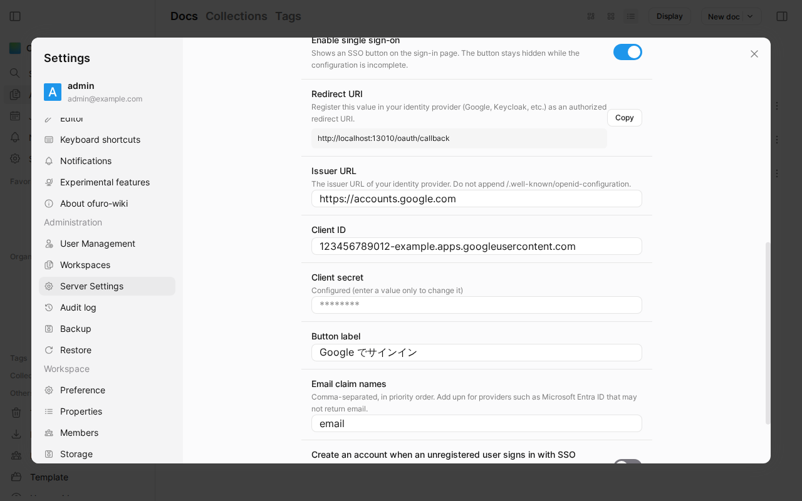
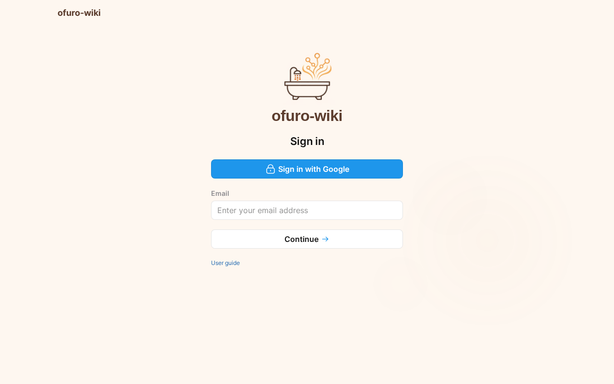

# Integrations

Settings for connecting to other systems. Do them only when you need them.

| Integration | What you get |
|---|---|
| [Single sign-on (SSO)](#single-sign-on-sso) | Sign in with your organization's Google Workspace, Microsoft Entra ID, Keycloak, or other accounts |
| [AI agents](#ai-agents) | Let AI such as Claude Code search, read, and edit pages |

## Single sign-on (SSO)

ofuro-wiki supports OpenID Connect (OIDC). Everything is set up in the admin panel; no `.env` edits or restarts are needed.

| IdP | Status |
|---|---|
| Google Workspace (app published as "Internal"), Keycloak | Verified |
| Microsoft Entra ID, Okta, and others | Expected to work (not verified) |

### 1. Note the redirect URI

In **Settings** → **Server Settings** → **Single sign-on (OIDC)**, copy the **Redirect URI**.

```
https://192.168.1.50/oauth/callback
```

It is built from `BASE_URL` in `.env`. Register it on the IdP side exactly, character for character.

### 2. Register an app with your IdP

**Google Workspace**

1. In the [Google Cloud Console](https://console.cloud.google.com/), select (or create) a project
2. In **APIs & Services** → **OAuth consent screen**, set the user type to **Internal**
3. **Credentials** → **Create credentials** → **OAuth client ID**. Type **Web application**; put the value from step 1 in **Authorized redirect URIs**
4. Note the client ID and client secret. The issuer URL is `https://accounts.google.com`
   - The client ID ends with `….apps.googleusercontent.com`, and the secret is a string of about 35 characters starting with `GOCSPX-`

**Keycloak**

1. Realm → **Clients** → **Create client** (OpenID Connect)
2. Turn on `Client authentication` and `Standard flow`
3. Put the value from step 1 in `Valid redirect URIs`
4. Note the client secret on the **Credentials** tab. The issuer URL is `https://<Keycloak host>/realms/<realm name>`

**Microsoft Entra ID**

1. **App registrations** → **New registration**. The redirect URI is the value from step 1, as **Web**
2. Create a secret in **Certificates & secrets** and note its value (it is shown only right after creation)
3. The issuer URL is `https://login.microsoftonline.com/<tenant ID>/v2.0` (`common` cannot be used)
4. Add `upn` to the email claim names (for example `email,upn`)

### 3. Configure ofuro-wiki

Enter the values in **Settings** → **Server Settings** → **Single sign-on (OIDC)**. Each value is saved as you enter it.

| Item | Value |
|---|---|
| Issuer URL | The issuer URL from step 2 |
| Client ID, client secret | The values you noted in step 2 (the secret is not shown again after saving; changing the issuer URL to a different value clears it, so enter it again) |
| Button label | Text of the button on the sign-in screen (for example `Sign in with your company account`) |
| Automatically create unregistered users on SSO sign-in | Decide with the table below |

Use **Test connection** to check that the issuer URL and the saved client ID and secret are correct, then turn on **Enable single sign-on**.
A wrong redirect URI cannot be detected by the connection test, so finish by actually signing in.



A button appears on the sign-in screen. It opens the IdP in a new tab, and after you sign in there you are in ofuro-wiki.



### Should automatic account creation be on

| IdP | Auto-create | Why |
|---|:-:|---|
| Only people in your organization can use it (Workspace "Internal", Entra ID, Keycloak) | On | New staff can start right away |
| People outside can also use it (regular Google accounts and so on) | **Off** | If on, **anyone** who can sign in to that IdP can use your wiki |

When it is off, an administrator creates accounts first ([Users and access](./users-and-access.md)). If the email address matches, SSO signs in to the same account.

### Notes on SSO

- Accounts created automatically by SSO **have no password**. They cannot sign in with a password
- Every press of the SSO button shows the IdP's account chooser. On a shared PC, you will not end up silently signed in as the previous person
- Changing `JWT_SECRET` in `.env` makes the saved secret unreadable. Enter the secret again
- Do not add claims that users can change themselves (such as `preferred_username`) to the email claim names. Someone could sign in by claiming another person's address

### When it does not work

| Symptom | Cause and fix |
|---|---|
| No SSO button on the sign-in screen | The issuer URL, client ID, or secret is empty. Review the items in step 3 |
| 「IdP との認証に失敗しました」 (authentication with the IdP failed) | The IdP rejects the client ID and secret pair. **Suspect the secret first.** Copy it again from the IdP and re-enter it (for Google, the one starting with `GOCSPX-`) |
| `redirect_uri_mismatch` on the IdP screen | The redirect URI registered at the IdP differs from the value in step 1, even by one character ([Troubleshooting](./troubleshooting.md#sso-shows-redirect-uri-mismatch)) |

For details, see [SSO setup (details)](https://github.com/ulysseus-inc/ofuro-wiki/blob/main/docs/sso-setup.md).

## AI agents

Settings that let AI agents such as Claude Code **read, revise, and write** ofuro-wiki pages.

To ofuro-wiki, an AI is **just another user**. It edits with the same permissions and through the same path as people.
Its edits appear right away in open browsers. Who edited is recorded in the audit log and the history.

### On the ofuro-wiki side (administrator)

1. Create an account for the AI ([Add users](./users-and-access.md#_1-add-users))
   - Create **one per person** (for example `taro+ai@example.com`). You can tell whose AI edited, and stop only that person's AI
   - **Set a password.** The AI signs in with a password. Even if you use SSO, create the AI account separately with a password (accounts created by SSO have no password, so the AI cannot sign in with them)
   - Do not make it an administrator
2. Invite it to a workspace and choose its role: member to let it write, reader to let it only read. Pages it should not touch can be [restricted page by page](./users-and-access.md#_4-restrict-who-can-see-a-page)

To stop an AI, change that account's password or delete it.

### On the AI agent side (the user's PC)

You need: Node.js 20 or later, the AI account's email address and password, and the ofuro-wiki URL

**For Claude Code**, run these two inside Claude Code:

```
/plugin marketplace add ulysseus-inc/ofuro-wiki
/plugin install ofuro-wiki@ofuro-wiki
```

Then, **in your own terminal**, save the connection details. It asks for the server URL, email address, and password.

```bash
node ~/.claude/plugins/marketplaces/ofuro-wiki/skills/ofuro-wiki-cli/scripts/ofuro.mjs login
```

- Only the URL, email address, and a token are saved — **the password is not**. The token expires after 30 days; log in again when it does
- **Do not type the password into the AI chat.** It stays in the conversation history

Finally, ask the AI to "show me the list of ofuro-wiki pages". If a list appears, you are done.

::: warning If you use a certificate from mkcert
The AI CLI runs on Node.js. **Node.js does not look at the CAs installed on your PC.**
As is, it fails with "cannot connect to the server".

On the PC that runs the AI, set the environment variable `NODE_EXTRA_CA_CERTS` to the location of the CA (the `rootCA.pem` distributed in [Install on a server](./install-server.md#_6-open-it-from-other-pcs)) before starting `login` and Claude Code.

```bash
# Mac / Linux (put it in ~/.bashrc or ~/.zshrc)
export NODE_EXTRA_CA_CERTS="$HOME/rootCA.pem"
```

```powershell
# Windows (once; reopen PowerShell and Claude Code afterwards)
setx NODE_EXTRA_CA_CERTS "$HOME\rootCA.pem"
```
:::

For other AI agents such as Codex CLI, and usage examples, see [AI agent setup (details)](https://github.com/ulysseus-inc/ofuro-wiki/blob/main/docs/ai-agent-setup.md) (in Japanese).
