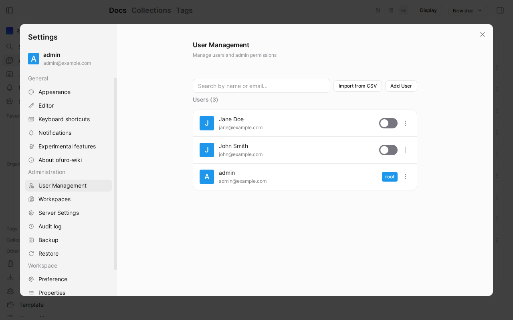
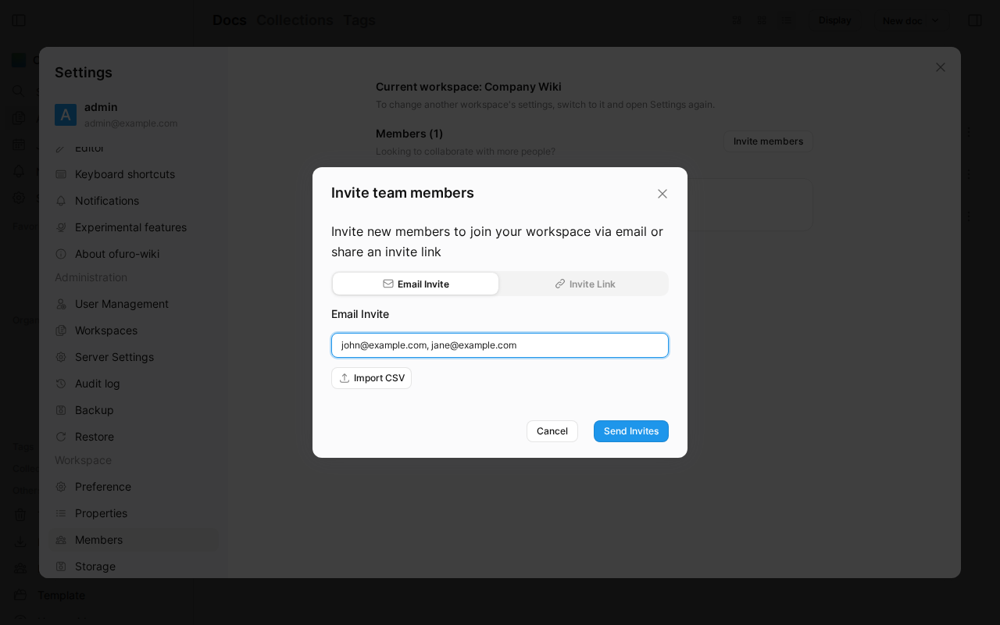
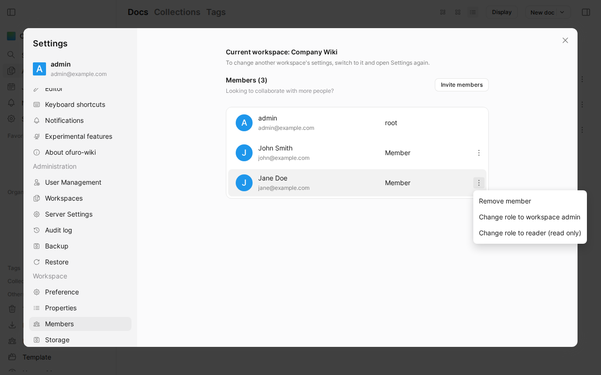
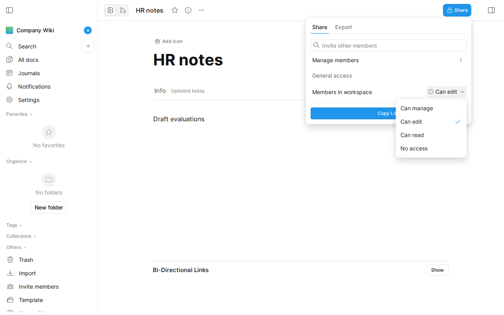
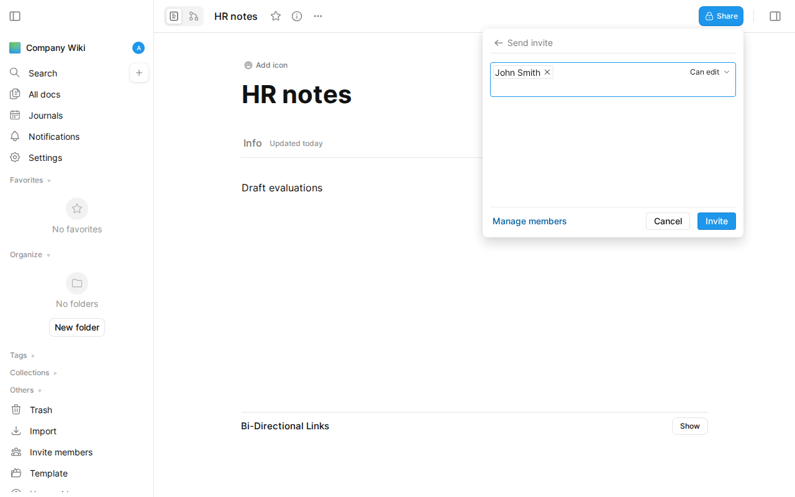

# Users and access

Decide who can use the wiki and which pages they can see. Permissions have three levels.

```
① Server     … can they sign in (do they have an account)? Are they a system admin (including root)?
   └ ② Workspace … are they invited, and with what role (workspace admin, member, reader)?
        └ ③ Page      … narrow down who can see or write each page
```

::: info Pages you cannot read are hidden entirely
In ofuro-wiki, pages you have no permission to read never appear in lists or search results. Not even their titles.
:::

## 1. Add users

Once new registration is disabled ([Initial setup](./initial-setup.md#_2-disable-new-registration)), system administrators create accounts.
People who received an invitation email or link can also create their own account from it (step 2).

### One at a time

In **Settings** → **User Management** → **Add User**, enter the email address, a password (8 characters or more), and a name, then create the user.



Tell the person their email address and password.
Ask them to change the password first in **Settings** → **Account**.

### In bulk (CSV)

**Import from CSV** creates any number of users from a CSV file (up to 500 rows at a time).

```csv
email,name,password
taro@example.com,Taro Yamada,Temp-Pass-0001
hanako@example.com,Hanako Suzuki,Temp-Pass-0002
```

- The first row is the header (`email,name,password`). Use UTF-8
- `email` and `password` are required. If `name` is empty, it is derived from the email address
- **Download template** gives you a starting file
- After loading, you first see OK/NG for each row (**nothing is registered yet**). Check it, then press the button to register

Passwords are not generated for you. Ask people to change their password after registration.

## 2. Invite people to a shared workspace

Creating an account alone does not let someone see the wiki's pages. Invite them to the wiki's shared workspace.
System administrators and workspace admins can invite. You cannot invite anyone to a private workspace.

Open the workspace, then in **Settings** → **Workspace** → **Members** → **Invite members**, enter email addresses and send the invites. Separate several addresses with commas.



- **People who already have an account become members immediately.** No email setup is needed
- **People without an account** receive an invitation email (email must be set up). Without email, use **Copy URL** in the message at the bottom right of the screen and give the invitation URL to them. They create an account from it and press **Accept & Join** to join — even when new registration is disabled
- The **Invitation link** section creates a link that lets anyone who has it join. If it leaks outside, anyone can join, so give it a short expiry

::: warning Give invitation URLs only to the invitee
Anyone holding an invitation URL for someone without an account can create an account with that email address. Send it in a way only the invitee can receive.
:::

## 3. Decide roles

Roles inside a shared workspace and what they can do. How each is decided differs.

| Role | How it is decided | Applies to | What they can do |
|---|---|---|---|
| root (owner) | `ROOT_EMAIL` in `.env` (one person) | **Every** shared workspace (no invitation needed) | Everything. root always owns every shared workspace (ownership cannot be transferred) |
| System admin | Turned on in **Settings** → **User Management** | **Every** shared workspace (no invitation needed) | Same as root. Only system admins choose or remove workspace admins |
| Workspace admin | Chosen by a system admin with "︙" after inviting | That workspace only | Workspace settings, inviting people, switching between member and reader, exporting |
| Member | Invited (the role right after inviting) | That workspace only | Read and write pages |
| Reader | Switched with "︙" after inviting | That workspace only | Read pages only |

- Workspace admin, member, and reader are set per workspace. The same person can be a member of the company wiki and a reader of the sales department's wiki
- root and system admins can manage any shared workspace from **Settings** → **Administration** → **Workspaces** → **Open**. They **cannot open other people's private workspaces**, though

Change roles in **Settings** → **Workspace** → **Members** with the "︙" on the person's row.



| Menu | What it does | Shown to |
|---|---|---|
| Change role to reader (read only) | Read only | System admins, workspace admins |
| Change role to member (can edit) | Allow reading and writing | System admins, workspace admins |
| Change role to workspace admin | Hand over management of the workspace | System admins |
| Remove member | Remove from the workspace (the account remains) | System admins, workspace admins |

## 4. Restrict who can see a page

For pages that only some people should see, such as HR or management pages, restrict them page by page.

1. Open the page and press **Share** at the top right
2. Under general access, set **Members in workspace** to **No access**
3. Type a name in **Invite other members** and pick the people who should see it
4. Choose the permission on the right (table below), then press **Invite**



| Permission | Read | Write, move to trash | Change this page's sharing |
|---|:-:|:-:|:-:|
| Can manage | ✅ | ✅ | ✅ |
| Can edit | ✅ | ✅ | ❌ |
| Read only | ✅ | ❌ | ❌ |
| No access (general access only) | ❌ | ❌ | ❌ |

- "Change this page's sharing" means showing or hiding the page for other people and changing their permissions. **People with Can manage can show the page to still more people**
- For people with no access, the page never appears in lists or search results



When you pick someone, the permission starts as **Can edit**. To let them only read, change it to **Read only** before inviting.
With **Can manage**, they can show the page to still more people.

::: warning Images, attachments, and comments cannot be restricted
Images and attachments on a page, and comments, are not covered by page restrictions. Anyone in the workspace can see them.
If the same group always needs access, creating a shared workspace just for them is more reliable.
:::

When someone without permission opens the page URL directly, they are told they have no access or the content was not found. They cannot tell whether the page exists.

::: info System admins and workspace admins can see it
In shared workspaces, system admins and workspace admins can open pages regardless of page permissions, so that the people who manage a workspace are never locked out.
:::

## 5. Forgotten password or lost device

Use the "︙" on the person's row in **Settings** → **User Management**.

| Menu | When to use |
|---|---|
| **Issue password URL** | Let the person set a new password themselves. Give them the URL (valid for 24 hours, usable once). The administrator never learns the password |
| **Reset password** | The administrator chooses a new password and tells the person |

**Changing a password signs the person out on all of their devices.**
If a PC or phone is lost, changing the password stops the lost device from being used.

::: warning The issued URL is as sensitive as a password
The URL alone lets someone change the password. Send it in a way only the person can receive. Once closed, it is not shown again.
:::

## 6. Delete a user

In **Settings** → **User Management**, press "︙" → **Delete** on the person's row. This cannot be undone.

::: danger Their private workspace is deleted too
Deleting a user also deletes their **private** workspace and all of its pages (the confirmation shows the workspace name).
Shared workspaces are not deleted (root owns them). Ask the person to move any pages they want to keep into a shared workspace before you delete them.
:::

root cannot be deleted.

To simply stop someone from signing in, for example when they leave, you can change their password instead of deleting them (step 5).

## 7. Add system administrators

In **Settings** → **User Management**, turn on the switch on the person's row to make them a system administrator. The list marks them **System admin** (root is marked **root**).

- root cannot be demoted or deleted. To change root, edit `ROOT_EMAIL` in `.env` and restart. Shared workspaces move to the new root (the previous root stays a system administrator)
- Only root can change root's password

## 8. Sign-in limits (no setup needed)

Protection against password guessing is on from the start.

| Limit | Details |
|---|---|
| Failed attempts | Up to 5 per 5 minutes for the same source and address |
| Account lock | After 10 failures in a row, the account is locked for 15 minutes and unlocks automatically |

While locked, the screen shows the same "Invalid password" as for a wrong password (so attackers cannot tell the account is locked).

If suspicious sign-in attempts continue, all administrators are notified by email. This requires email (SMTP) to be set up.

## 9. See who did what

**Settings** → **Administration** → **Audit log** shows records of sign-ins, adding and deleting users, creating and changing pages, permission changes, folder operations, and more.
Filter by date, user, and action. Only system administrators can see it.

### Records of opened pages (optional)

In **Settings** → **Administration** → **Server Settings** → **Audit log**, you can also record **who opened which page**. It is off by default.

- Only pages in shared workspaces are recorded (private workspaces are not)
- However many times a person opens the same page in a day, only the first is recorded
- This is a record of individual behavior. Tell your users before turning it on. It also increases the volume of the log
