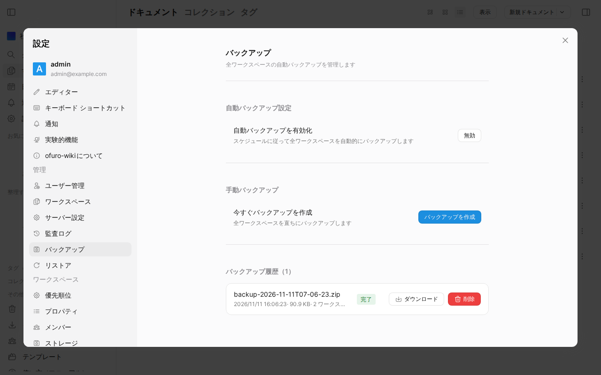
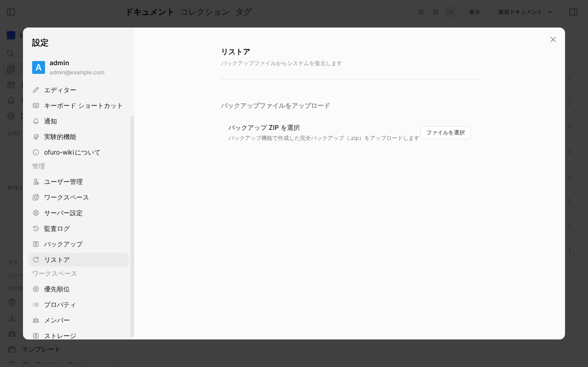
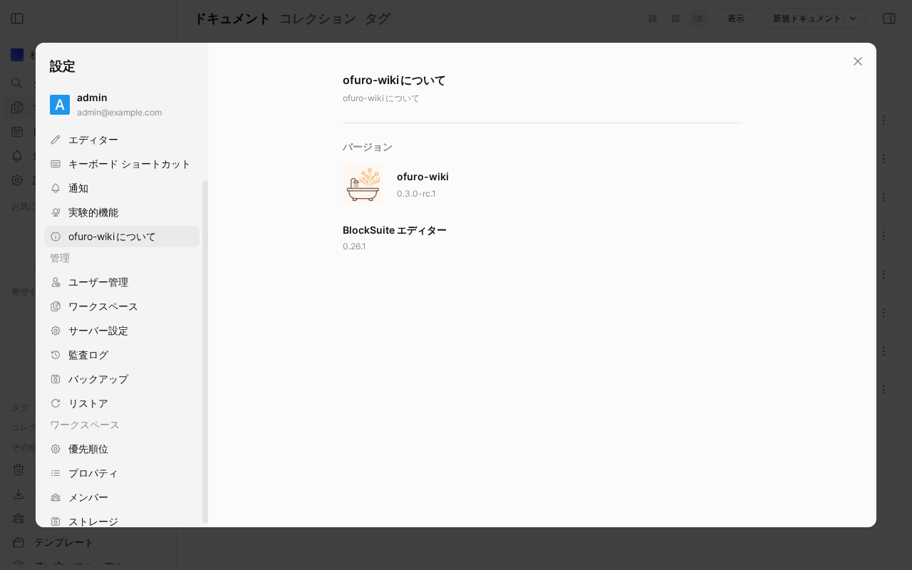

# 運用

導入した後に続ける作業は、主に 2 つです。

- **バックアップ**：データを失わないように、写しを取っておく
- **バージョンアップ**：新しいバージョンが出たら、ofuro-wiki をバージョンアップする

ほかに、2 年に 1 回ほど、証明書を更新します。

コマンドは、サーバーの `~/ofuro-wiki`（[社内サーバーへの導入](./install-server.md) で作ったフォルダー）で実行します。

## 1. バックアップ

バックアップには、**すべてのワークスペース・ページ・画像や添付ファイル・ユーザー**が入ります。
1 つの ZIP ファイルで、システム全体をその時点に戻せます。

### 自動で取る

設定 →「**バックアップ**」→「**自動バックアップを有効化**」をオンにします。

| 項目 | 選べるもの |
|---|---|
| スケジュール | 毎日・毎週・毎月 |
| 保持期間（日） | この日数より古いバックアップを消す |

自動バックアップは **3:00** に動きます（[社内サーバーへの導入](./install-server.md) の設定で、日本時間になっています）。
バックアップが失敗した日は、古いバックアップを消しません。

### すぐに取る

「**バックアップを作成**」を押します。「作成中」から「完了」に変われば終わりです。



「ダウンロード」で、ZIP を手元の PC に保存できます。

### 別の場所にも写す

バックアップの ZIP は、サーバーの `~/ofuro-wiki/backups` にたまります。
**サーバーのディスクが壊れると、バックアップも一緒に失います。** NAS など、別の場所にも写してください。

たとえば NAS を `/mnt/nas` につないでいるなら、毎日 4:00 に写すには、`sudo crontab -e` で次の 1 行を足します。

```bash
0 4 * * * rsync -a /home/user/ofuro-wiki/backups/ /mnt/nas/ofuro-wiki-backups/
```

- `/home/user` は、自分のホームフォルダーに読み替えます
- `backups` の中のファイルは管理者（root）の持ち物なので、root の crontab で動かします

### バックアップに入らないもの

次の 2 つはバックアップに入りません。**別に、安全な場所に控えておいてください。**

| もの | 場所 | 無いと困ること |
|---|---|---|
| `.env` | `~/ofuro-wiki/.env` | 作り直すと、全員のサインインが切れる。DB のパスワードも分からなくなる |
| 認証局 | `~/.local/share/mkcert` | 証明書を作り直すと、社内の全 PC に認証局を配り直すことになる |

どちらも秘密の情報です。人に見られない場所に置いてください。

### ワークスペースだけを書き出す・取り込む

システム全体ではなく、**1 つのワークスペース**を ZIP（`.ofuro-backup.zip`）にできます。別の ofuro-wiki へ移すときや、部署の Wiki だけを控えておくときに使います。

| 操作 | やり方 | できる人 |
|---|---|---|
| 書き出す | そのワークスペースを開き、設定 →「ワークスペース」→「**ストレージ**」→「Export Workspace」の「**Export**」 | 共有: システム管理者・ワークスペース管理者／プライベート: 本人 |
| 取り込む | 設定 →「管理」→「**ワークスペース**」→「**取り込み**」で ZIP を選ぶ。**新しい共有ワークスペース**として作られる | システム管理者 |

- 取り込んだワークスペースのメンバーは root だけです（システム管理者は、招待なしで管理できます）。使う人を招待し直してください
- ユーザーやパスワードは入りません。システム全体を戻すときは、上の「バックアップ」を使います

## 2. 復元する

バックアップの時点に、システム全体を戻します。

1. 設定 →「**リストア**」→「**ファイルを選択**」で、バックアップの ZIP を選びます
2. 「**リストア**」を押します
3. 確認が出たら「リストア」を押します



::: danger 今のデータは、すべて置き換わります
バックアップの後に作ったページや、加えた変更は消えます。取り消せません。
ユーザー・パスワード・権限も、バックアップの時点に戻ります。
:::

- 復元している間、同時編集は止まります。終わると画面が読み込み直されます
- 使っている人には、事前に知らせてください。復元の後は、ブラウザを読み込み直してもらいます
- バックアップの一覧は戻りません（今あるバックアップは、そのまま残ります）

## 3. ofuro-wiki をバージョンアップする

### 今のバージョンを確かめる

設定 →「**ofuro-wikiについて**」に、バージョンが出ます。



新しいバージョンは、[リリースの一覧](https://github.com/ulysseus-inc/ofuro-wiki/releases) で確かめます。
**バージョンアップの前に、そのバージョンの注意を読んでください。** バージョンによっては、前後にやることがあります。

### バージョンアップする

1. **バックアップを取ります。** 設定 →「バックアップ」→「バックアップを作成」。念のため、ZIP をダウンロードしておきます
2. 使っている人に、数分止まることを知らせます
3. バージョンを固定している場合は、`.env` のバージョンを書き換えます（`latest` のままなら不要）

   ```ini
   APP_IMAGE=ghcr.io/ulysseus-inc/ofuro-wiki:0.3.0
   POSTGRES_IMAGE=ghcr.io/ulysseus-inc/ofuro-wiki-postgres:0.3.0
   ```

4. 新しいイメージを取ってきて、起動し直します

   ```bash
   docker compose pull
   docker compose up -d --no-build
   ```

5. `docker compose ps` で、`app` が `(healthy)` になるまで待ちます。数分かかります
6. ブラウザで開き、設定 →「ofuro-wikiについて」で、新しいバージョンになっていることを確かめます

起動するときに、データベースの更新が自動で行われます。手で行う作業はありません。

### 前のバージョンに戻す

データベースの更新は、前のバージョンの形には戻せません。前のバージョンに戻すときは、**バージョンアップの前に取ったバックアップ**が要ります。

1. `.env` のバージョンを、前のバージョンに書き戻します
2. `docker compose up -d --no-build` で起動し直します
3. 設定 →「リストア」で、バージョンアップの前に取ったバックアップから復元します

戻した後は、バージョンアップした後に作ったページや変更は消えています。

::: warning この戻し方は、まだ実地で確かめていません
データベースの更新を含むバージョンで、前のバージョンに戻して起動できるかは確かめていません。起動しないときは、開発元に相談してください。
:::

## 4. 証明書を更新する

mkcert で作ったサーバーの証明書は、**作ってから 2 年 3 か月**で切れます。切れると、ブラウザに `NET::ERR_CERT_DATE_INVALID` の警告が出ます。
期限は、作ったときに「It will expire on …」と出ています。後から確かめるときは、次を実行します。

```bash
openssl x509 -enddate -noout -in certs/cert.pem
```

期限の前に、作ったときと同じコマンドで作り直し、Caddy を起動し直します。

```bash
mkcert -cert-file certs/cert.pem -key-file certs/key.pem 192.168.1.50 localhost
docker compose restart caddy
```

認証局（`rootCA.pem`）の期限は 10 年です。証明書を作り直しても、社内の PC に配り直す必要はありません。
